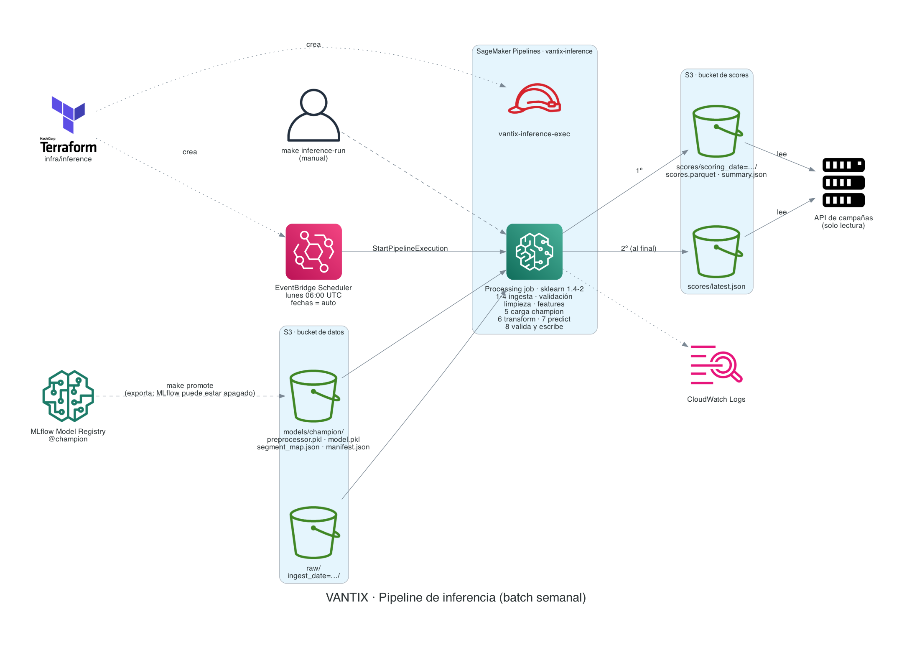

# VANTIX · Arquitectura del pipeline de inferencia

Cada semana, el pipeline asigna a cada cliente el segmento del modelo `@champion` y le deja el resultado a la API de campañas.

## 1. Tech stack

| Capa | Tecnología |
|---|---|
| Disparo | EventBridge Scheduler (semanal) |
| Orquestación y cómputo | SageMaker Pipelines → 1 Processing job (contenedor oficial scikit-learn 1.4-2 + `requirements.txt`) |
| Datos | pandas + Parquet en S3 |
| Artefactos | `models/champion/` en S3 (lo exporta `make promote` desde MLflow) |
| Salida | Bucket S3 propio para scores, que lee la API de campañas |
| IaC | Terraform en `infra/inference/`. El pipeline lo crea el SDK con `upsert`, igual que en entrenamiento |

## 2. Diagrama general



> Generado con `make diagrams` desde `docs/inference_pipeline_diagram.py`.

```
                         ┌──────────────────────────┐
                         │ EventBridge Scheduler    │  cron semanal
                         │ (o `make inference-run`) │
                         └────────────┬─────────────┘
                                      │ StartPipelineExecution
                                      ▼
 S3 · bucket de datos        SageMaker Pipeline: vantix-inference           S3 · bucket de scores
 ────────────────────        ┌─ Processing job (sklearn 1.4-2) ─────────┐   ─────────────────────
 raw/ingest_date=…/ ───────▶ │ 1 Ingesta                                │
                             │ 2 Validación  (falla → se corta)         │
                             │ 3 Limpieza                               │
                             │ 4 Features    (pipelines/common)         │
 models/champion/ ─────────▶ │ 5 Carga de artefactos                    │
   preprocessor.pkl          │ 6 preprocessor.transform()               │
   model.pkl                 │ 7 model.predict()  +  segment_map        │
   segment_map.json          │ 8 Validación de salida + escritura       │──▶ scores/scoring_date=…/
   manifest.json             └──────────────────────────────────────────┘      scores.parquet
        ▲                                     │                                summary.json
        │ make promote                        ▼                              scores/latest.json
        │ (exporta @champion)          CloudWatch Logs                              │
 MLflow (SageMaker)                                                                 ▼
 Model Registry                                                             API de campañas
 vantix-segmentation@champion                                               (solo lectura)
```

**Relaciones:**
- **Scheduler → Pipeline:** lo lanza una vez por semana, con un rol propio que solo tiene `StartPipelineExecution`.
- **Pipeline → S3 de datos:** lee `raw/` y `models/champion/`. No escribe en este bucket.
- **Pipeline → S3 de scores:** es el único que escribe ahí.
- **API de campañas → S3 de scores:** solo lectura. Lee primero `latest.json` y después la partición a la que apunta.
- **MLflow:** solo interviene al promover. La inferencia **no** lo necesita encendido.

## 3. Pasos

1. **Ingesta.** Lee el último `raw/ingest_date=YYYY-MM-DD/data.parquet` (`IngestDate=auto`), con transacciones crudas y el mismo esquema que en entrenamiento. Tiene que cubrir al menos los 30 días de la ventana.
2. **Validación.** La misma `validate(df)` que en entrenamiento: esquema, nulos, `TransId`, BetType, rangos y volumen. Además, el lote debe llegar hasta `snapshot_date`; si no, Recency saldría inflada. Si algo falla, el job se corta y no se escribe nada.
3. **Limpieza.** La misma `clean(df)`.
4. **Features.** La misma `build_user_features(df, snapshot_date, window_days=30)`, una fila por usuario.
   - `snapshot_date` = fecha de la corrida − 1 día. Los parámetros de fecha valen `auto` por defecto; con los datos históricos actuales se fija `SnapshotDate=2025-04-30`.
5. **Carga de artefactos.** Lee `preprocessor.pkl`, `model.pkl`, `segment_map.json` y `manifest.json` desde `models/champion/`.
6. **Preprocesamiento.** `preprocessor.transform(X)`, **sin `fit()`**.
7. **Predicción.** `model.predict(X_t)` → `cluster_id`, y `segment_map` → `segment_name`.
8. **Validación de salida y escritura.**
   - Comprueba que todos los usuarios estén puntuados exactamente una vez y que `cluster_id` esté en `0..k-1`.
   - Escribe `scores.parquet` y `summary.json` en `scores/scoring_date=YYYY-MM-DD/`.
   - Al final, sobrescribe `scores/latest.json`. Así la API nunca lee una corrida a medias.
   - El script escribe en S3 él mismo (sin `ProcessingOutput`, que sube todo al terminar sin un orden garantizado) para que `latest.json` sea siempre lo último.

## 4. Contrato de salida

`scores/scoring_date=YYYY-MM-DD/scores.parquet`, una fila por cliente:

| Columna | Tipo | Origen |
|---|---|---|
| `customer_id` | str | `UserName` |
| `cluster_id` | int | `model.predict()` |
| `segment_name` | str | `segment_map.json` |
| `model_version` | str | `manifest.json` (versión de `vantix-segmentation`) |
| `scoring_date` | date | fecha de la corrida |

`scores/latest.json`:

```json
{"scoring_date": "2025-05-01",
 "path": "s3://vantix-<cuenta>-scores/scores/scoring_date=2025-05-01/scores.parquet",
 "model_version": "3", "rows": 108008}
```

`summary.json`: número de usuarios por segmento, `snapshot_date`, `raw_sha256`, `model_version`, `training_git_commit` (del manifest), `inference_git_commit` (del pipeline) y duración. Sirve para revisar de un vistazo si la distribución cambió.

## 5. Artefactos: de MLflow a S3

- La fuente de verdad sigue siendo el **Model Registry** (`vantix-segmentation@champion`).
- `make promote`, además de asignar el alias, **exporta los tres archivos del run** a `s3://<bucket-datos>/models/champion/`, junto con un `manifest.json` (`model_version`, `run_id`, `k`, `snapshot_date`).
- **Motivo:** MLflow cuesta USD 0,60/h y se mantiene apagado (`make mlflow-stop`). Una tarea semanal no puede depender de que esté encendido.
- Los tres archivos siempre vienen del mismo run. Para volver a un modelo anterior se reasigna `@champion` y se vuelve a ejecutar la exportación.

## 6. Infraestructura (`infra/inference/`)

- **Bucket de scores:** con versioning, cifrado y acceso privado.
- **Rol de ejecución del pipeline:**
  - leer `raw/` y `models/champion/`;
  - escribir en el bucket de scores;
  - logs, y pull del contenedor oficial desde ECR.
- **EventBridge Scheduler:** cron semanal (`cron(0 6 ? * MON *)`, UTC) y un rol que solo tiene `sagemaker:StartPipelineExecution`. Se crea **apagado**: se activa con `make schedule-on` después de validar una corrida manual.
- **Lectura para la API de campañas:** política de solo lectura sobre el bucket de scores. Su ARN se pasa como variable.
- **El pipeline de SageMaker** se crea con el SDK (`upsert`), no con Terraform.

## 7. Decisiones y límites

- **Batch semanal, sin tiempo real:** no hacen falta endpoints ni Feature Store.
- **Processing job, no Batch Transform:**
  - Las features se agregan por usuario sobre todas sus transacciones. Batch Transform parte la entrada y rompería esa agregación.
  - Además, exige un servidor HTTP y una cuota aparte.
- **Sin Docker propio ni ECR propio:** se usa el contenedor oficial, como en entrenamiento.
- **Features como código común, no como artefacto:** el mismo `pipelines/common` en entrenamiento e inferencia evita que el cálculo difiera entre ambos (training-serving skew).
  - No se meten en un `sklearn.Pipeline` porque cambian el grano (de transacción a usuario), necesitan el `customer_id` y dependen de un `snapshot_date` que cambia en cada corrida.
- **`preprocessor.pkl` y `model.pkl` separados:** se mantiene igual que en entrenamiento.
- **Idempotente:** volver a correr el mismo `scoring_date` sobrescribe su partición. El versioning del bucket guarda la anterior.
- **Fuera de alcance:**
  - la carga semanal de `raw/`: hoy se hace con `make upload-raw`; en producción, la hará un proceso aguas arriba;
  - juego responsable;
  - el grupo de control y la medición de campañas;
  - CI/CD, que se define más adelante.
