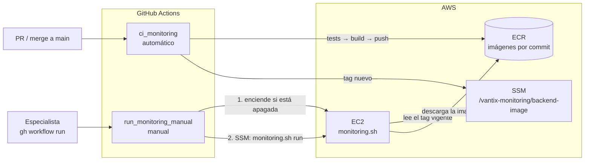

# CI/CD del sistema de monitorización

Dos workflows de GitHub Actions con responsabilidades separadas: el **CI** publica el código y el **CD** lo ejecuta. Terraform solo gestiona la infraestructura.



## 1. CI: `ci_monitoring.yml` (automático)

| Evento | Qué hace |
|---|---|
| Cada PR | Tests de `monitorization/tests/` + `terraform fmt/validate` de `monitorization/infra`. Es el check obligatorio `monitoring-tests`: si falla, el PR no se puede mergear. |
| Merge a `main` con cambios en el código de la imagen (`monitorization/src`, `docker`, `tests` o los 4 archivos compartidos de `pipelines/common`) | Tests → build de la imagen → push a ECR (tag = commit) → actualiza el **puntero SSM** con ese tag. |

Si los tests fallan, no se construye nada y el puntero sigue en la última versión buena.

## 2. CD: `run_monitoring_manual.yml` (manual)

Lo lanza el especialista cuando lo decide, desde su consola, sin clonar el repo (solo necesita `gh` autenticado):

```bash
gh workflow run run_monitoring_manual.yml -R kevin-ja/vantix                          # data nueva (última partición)
gh workflow run run_monitoring_manual.yml -R kevin-ja/vantix -f ingest_date=2025-07-31
gh workflow run run_monitoring_manual.yml -R kevin-ja/vantix -f job=build_benchmark -f ingest_date=2025-04-30
gh workflow run run_monitoring_manual.yml -R kevin-ja/vantix -f stop_after=true       # apaga la EC2 al terminar
gh run watch -R kevin-ja/vantix                                                       # seguir la ejecución
```

Pasos:
1. Enciende la EC2 si está apagada (API de EC2, no Terraform) y espera a que responda por SSM.
2. Por SSM ejecuta `monitoring.sh run <job>` en el servidor:
   - lee el tag vigente del puntero SSM, descarga esa imagen de ECR;
   - levanta `db` + `frontend` (con `restore` si la base está vacía);
   - corre el job (`run_monitoring` o `build_benchmark`).
3. Muestra el resumen (imagen usada, corrida, alertas) y el enlace al dashboard.
4. Opcional (`stop_after`): espera 2 min para que Grafana evalúe y envíe la alerta, y apaga la EC2.

Sin aprobación: solo lee datos y escribe métricas, no cambia nada de producción.

## 3. El puntero SSM

`/vantix-monitoring/backend-image` guarda el tag de la imagen vigente. Lo escribe solo el CI, después de pasar los tests desde `main`.

- **Por qué un puntero y no "la última imagen de ECR":** solo se usa una imagen aprobada, nunca una subida a mano o desde una rama.
- **Trazabilidad:** cada corrida registra su imagen (`runs.git_commit`) y SSM guarda el historial del parámetro.
- **Rollback:** `cd monitorization && make set-image TAG=<tag anterior>` (el resumen del CI muestra el anterior).

## 4. Qué hace cada pieza

| Pieza | Responsabilidad | Cuándo cambia |
|---|---|---|
| `ci_monitoring.yml` | Publicar código: imagen en ECR + puntero | Cada merge que toca el código |
| `run_monitoring_manual.yml` | Ejecutar: encender + deploy + run | Cada corrida (manual) |
| `server/monitoring.sh` | Deploy en el servidor: puntero → pull → compose → job | Lo instala el arranque de la EC2 |
| Terraform (`make up`) | Infraestructura: EC2, red, buckets, roles, Grafana, compose | Rara vez, al cambiar la infra (reemplaza la EC2; los datos vuelven desde S3) |

## 5. Acceso a AWS (OIDC, sin llaves)

Un rol por workflow, con permisos mínimos, que solo pueden asumir ejecuciones desde `main` (`monitorization/infra/github.tf`):

| Rol | Workflow | Permisos |
|---|---|---|
| `vantix-monitoring-github-ci` | `ci_monitoring` | Push al repo de ECR del backend; leer/escribir el puntero |
| `vantix-monitoring-github-run` | `run_monitoring_manual` | Encender/apagar y enviar comandos SSM solo a la EC2 del monitoreo (por tag); leer el puntero |

Variables del repo en GitHub: `GH_MONITORING_CI_ROLE_ARN`, `GH_MONITORING_RUN_ROLE_ARN`, `MONITORING_GRAFANA_URL`.
