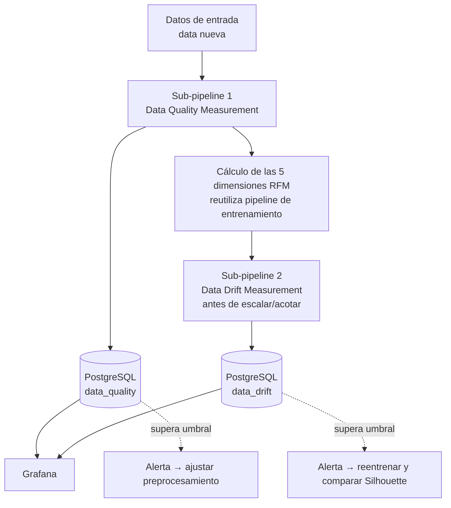

# Arquitectura del sistema de monitorización (draft)

> **Estado:** borrador. Las secciones marcadas como **Pendiente** aún no están definidas.

## 1. Componentes

| Componente | Tecnología | Notas |
|---|---|---|
| Backend | CloudWatch + scripts de Python | Muy probablemente |
| Database | PostgreSQL | Tablas `data_quality` y `data_drift` |
| Frontend | Grafana | |

## 2. Regla de decisión

Responde a: **¿qué pasa cuando un umbral es alcanzado?** Depende de dos escenarios:

### 2.1. Data Quality

- **Disparador:** alguna métrica de Data Quality supera su umbral.
- **Acción:** enviar una alerta (correo).
- **Respuesta esperada:** el ML engineer ajusta el pipeline de preprocesamiento, porque están cambiando las métricas de calidad de los datos.

### 2.2. Data Drift

- **Disparador:** alguna métrica de drift supera su umbral.
- **Acción:** enviar una alerta.
- **Respuesta esperada:** el ML engineer reentrena el modelo:
  1. Reentrenar un modelo.
  2. Comparar las performance metrics del nuevo modelo frente al antiguo. Al ser K-means, se comparan métricas como el **Silhouette Score**.

## 3. Pipeline de monitorización

### 3.0. Datos de entrada

Entra **data nueva**, no la data histórica (con la que el modelo ha sido entrenado). La data histórica se usa solo como benchmark (ver sección 4).

### 3.1. Sub-pipeline 1: Data Quality Measurement

Trabaja sobre los datos de entrada y calcula cinco métricas sobre las 8 columnas que entran en el cálculo de las 5 dimensiones RFM: `TransId`, `TransDate`, `UserName`, `Actual_Stake`, `ActualRate`, `Winlost`, `Odds`, `BetType`.

| Métrica | Definición | ✅ Bien | ❌ Mal | Criterio (para el cálculo) |
|---|---|---|---|---|
| **Nulos** | Alguna de las 8 columnas viene vacía. | Toda apuesta trae `UserName`, `Actual_Stake` y `Odds`. | Apuesta sin `UserName` o sin `Actual_Stake`. | Es nulo: `NaN`, `None`, `NaT`, string vacío `""` o solo espacios. **El 0 no es nulo.** |
| **Duplicados** | La misma apuesta aparece dos veces con todos sus valores iguales. | Cada `TransId` aparece una sola vez. | `TransId=151823612` dos veces con los mismos valores. | Filas idénticas en todas sus columnas (`df.duplicated()`), mismo criterio que `clean()` en entrenamiento. |
| **Valores inválidos** | Un valor imposible para su columna, mirado por sí solo. | `Actual_Stake=85.6`, `Odds=-1.07`, `BetType=9`. | `Actual_Stake=0`, `Odds=0`, `BetType=12`. | Válido si: `TransId` entero > 0 · `TransDate` fecha parseable y no futura · `UserName` cumple `user_<número>` · `Actual_Stake` > 0 · `ActualRate` > 0 · `Winlost` ≥ 0 · `Odds` ≠ 0 · `BetType` ∈ {1…9}. |
| **Consistencia** | Valores válidos por separado que juntos no tienen sentido. | `BetType=5` con `Odds=1.85`; `Stake=100`, `Odds=2.0`, `Winlost=200`. | `BetType=5` con `Odds=0.9`; `Stake=100`, `Odds=2.0`, `Winlost=500`. | 1) `BetType` ∈ {4, 5, 6, 8} (cuota decimal) → `Odds` > 1. 2) `Winlost` ≤ `Actual_Stake` × cuota decimal (`odds_to_decimal`), tolerancia 0,01 % por redondeo. 3) Un mismo `TransId` siempre con el mismo contenido. |
| **Completitud** | El lote cubre los 30 días de la ventana, sin días faltantes. | Ventana 04-01 → 04-30 con apuestas los 30 días. | Faltan 04-25 → 04-30. | 1) Cada día de `[snapshot_date − 29, snapshot_date]` tiene ≥ 1 fila. 2) El `TransDate` máximo cae en `snapshot_date` (si no, Recency sale inflada). |

Notas (verificadas en `data/data.csv`, 842.163 filas):

- **El 0 no es nulo:** `Winlost` (lo devuelto al apostador) vale 0 cuando pierde (381.873 filas, 82 % de las `LOSE`). Donde el 0 es imposible (`Actual_Stake`, `ActualRate`, `Odds`), lo detecta la métrica de inválidos.
- **Cuotas:** decimales (4, 5, 6, 8) entre 1,01 y 300; asiáticas (1, 2, 3, 7, 9) entre −100 y 11,11, pueden ser negativas, por eso solo se exige `Odds` ≠ 0.
- **`ActualRate`:** 18 valores (uno por moneda); no se restringe a esa lista porque una moneda nueva no es un error.
- **`TransDate` anterior a la ventana** no es inválido: el pipeline lo filtra a propósito.

Los resultados se almacenan en la tabla **`data_quality`** (PostgreSQL).

### 3.2. Cálculo de las cinco dimensiones RFM

Se calculan las cinco dimensiones del modelo de clusterización (Recency, Frequency, Monetary, etc.). Ya existe un pipeline de entrenamiento que las calcula; posiblemente se reutilice.

### 3.3. Sub-pipeline 2: Data Drift Measurement

Se ejecuta sobre las cinco dimensiones RFM **antes del preprocesamiento** (escalado, acotado, etc.). Calcula dos indicadores:

1. **PSI (Population Stability Index):** cuantifica el cambio de una distribución.
2. **KS (Kolmogorov-Smirnov):** medida estadística que indica si la distribución cambió o no estadísticamente.

Los resultados se almacenan en la tabla **`data_drift`** (PostgreSQL).

## 4. Benchmark

Aunque la monitorización se haga sobre la data nueva, se necesita un benchmark: las mismas métricas de Data Quality y Data Drift, pero calculadas sobre la data histórica (la data con la que el modelo ha sido entrenado).

**Justificación:** el drift de distribución se debe medir respecto a la data o lote que el modelo aprendió. Lo que importa es si la data de hoy, o la más reciente, se sigue pareciendo o no a la data histórica con la que el modelo fue entrenado. Así trabajan los sistemas de monitoreo como SageMaker Model Monitor, Evidently AI, WhyLabs y NannyML.

## 5. Umbrales (thresholds)

### 5.1. KS

| Rango | Clasificación |
|---|---|
| 0 – 0.05 | Cambio pequeño |
| 0.05 – 0.1 | Cambio moderado |
| 0.1 – 0.2 | Cambio considerable |
| > 0.2 | Cambio importante |

### 5.2. PSI

| Rango | Clasificación |
|---|---|
| < 0.1 | Cambio pequeño |
| 0.1 – 0.25 | Cambio moderado |
| > 0.25 | Cambio significativo |

### 5.3. Data Quality

Se miden sobre las columnas que entran en el cálculo de las 5 dimensiones RFM. Si el pipeline de entrenamiento trata el caso, se tolera un rango; si no, cualquier presencia dispara una alerta.

| Métrica | ¿El pipeline de entrenamiento lo trata? | Umbral |
|---|---|---|
| Nulos | No | > 0 → alerta |
| Duplicados | Sí | < 0,5 % pequeño · 0,5–1 % moderado · 1–5 % considerable · > 5 % importante |
| Valores inválidos | No | > 0 → alerta |
| Consistencia | No | > 0 → alerta |
| Completitud | No | > 0 → alerta |

## 6. Pendientes

- [ ] Definir qué nivel de KS/PSI dispara la alerta de drift.
