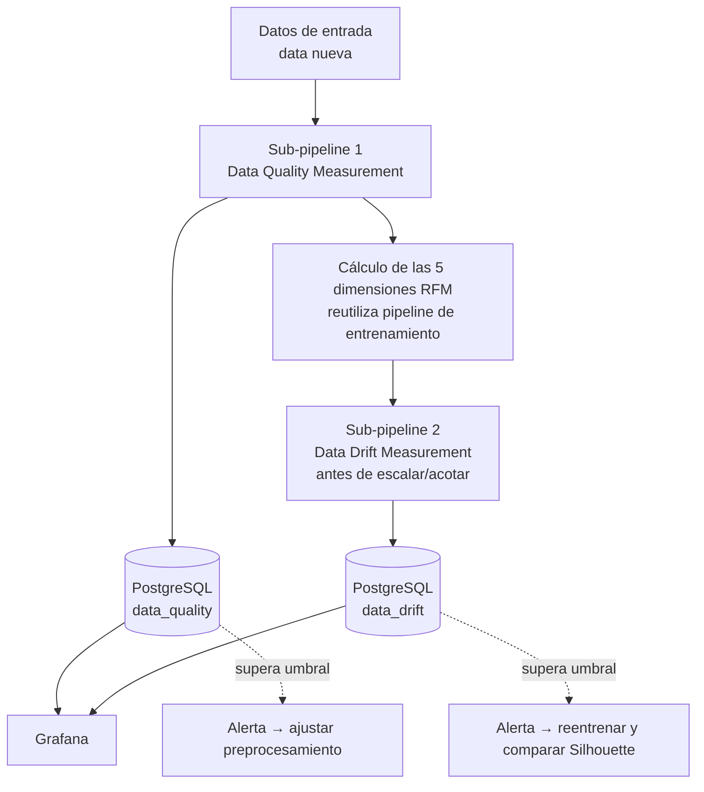
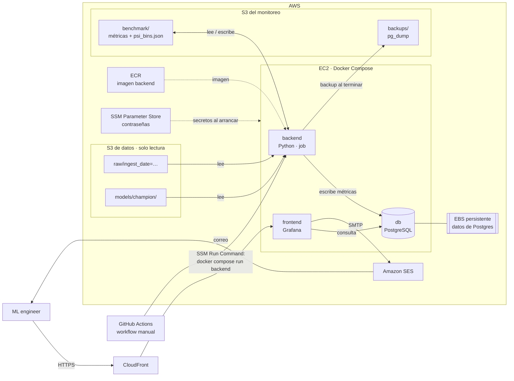

# Arquitectura del sistema de monitorización

> **Estado:** implementado y desplegado en AWS (PR #11 y #12). CI/CD: [`ci_cd.md`](ci_cd.md).

## 1. Componentes

| Componente | Tecnología | Notas |
|---|---|---|
| Backend | Scripts de Python (job) | Calcula métricas; sin CloudWatch (ver [8.9. Sin CloudWatch](#89-sin-cloudwatch)) |
| Database | PostgreSQL | Tablas `data_quality` y `data_drift` |
| Frontend | Grafana | Dashboard + alertas (Grafana Alerting) |

## 2. Regla de decisión

Responde a: **¿qué pasa cuando un umbral es alcanzado?**

Principios generales:

- **Solo avisa, no bloquea:** una alerta no frena la inferencia; la inferencia corre igual.
- **Por evento:** las alertas se evalúan cada vez que corre el pipeline de monitorización. Si todo está bien, no se hace nada; si hay alertas, el ML engineer abre el dashboard de Grafana, analiza y decide si hay que actuar.
- **Revisión manual:** la alerta solo informa. Un especialista la analiza y decide, junto con negocio, qué peso darle. El cambio de modelo se decide reentrenando con la data nueva y comparando métricas de performance (Silhouette Score, entre otras) y criterios de negocio; por eso el pipeline de entrenamiento es manual.
- **Frecuencia:** semanal, con un workflow de GitHub Actions disparado manualmente (se define en la etapa de CI/CD).

Depende de dos escenarios:

### 2.1. Data Quality

- **Disparador:** alguna métrica de Data Quality supera su umbral.
- **Acción:** enviar una alerta (correo).
- **Respuesta esperada:** el ML engineer ajusta el pipeline de preprocesamiento, porque están cambiando las métricas de calidad de los datos.

### 2.2. Data Drift

- **Disparador:** alguna métrica de drift supera su umbral.
- **Acción:** enviar una alerta.
- **Respuesta esperada:** el ML engineer reentrena el modelo:
  1. Reentrenar un modelo.
  2. Comparar las performance metrics del nuevo modelo frente al antiguo. Al ser K-means, se comparan métricas como el **Silhouette Score**.

## 3. Pipeline de monitorización



### 3.0. Datos de entrada

Entra **data nueva**, no la data histórica (con la que el modelo ha sido entrenado). La data histórica se usa solo como benchmark (ver sección 4).

### 3.1. Sub-pipeline 1: Data Quality Measurement

Trabaja sobre los datos de entrada y calcula cinco métricas sobre las 8 columnas que entran en el cálculo de las 5 dimensiones RFM: `TransId`, `TransDate`, `UserName`, `Actual_Stake`, `ActualRate`, `Winlost`, `Odds`, `BetType`.

| Métrica | Definición | ✅ Bien | ❌ Mal | Criterio (para el cálculo) |
|---|---|---|---|---|
| **Nulos** | Alguna de las 8 columnas viene vacía. | Toda apuesta trae `UserName`, `Actual_Stake` y `Odds`. | Apuesta sin `UserName` o sin `Actual_Stake`. | Es nulo: `NaN`, `None`, `NaT`, string vacío `""` o solo espacios. **El 0 no es nulo.** |
| **Duplicados** | La misma apuesta aparece dos veces con todos sus valores iguales. | Cada `TransId` aparece una sola vez. | `TransId=151823612` dos veces con los mismos valores. | Filas idénticas en todas sus columnas (`df.duplicated()`), mismo criterio que `clean()` en entrenamiento. |
| **Valores inválidos** | Un valor imposible para su columna, mirado por sí solo. | `Actual_Stake=85.6`, `Odds=-1.07`, `BetType=9`. | `Actual_Stake=0`, `Odds=0`, `BetType=12`. | Válido si: `TransId` entero > 0 · `TransDate` fecha parseable y no futura · `UserName` cumple `user_<número>` · `Actual_Stake` > 0 · `ActualRate` > 0 · `Winlost` ≥ 0 · `Odds` ≠ 0 · `BetType` ∈ {1…9}. |
| **Consistencia** | Valores válidos por separado que juntos no tienen sentido. | `BetType=5` con `Odds=1.85`; `Stake=100`, `Odds=2.0`, `Winlost=200`. | `BetType=5` con `Odds=0.9`; `Stake=100`, `Odds=2.0`, `Winlost=500`. | 1) `BetType` ∈ {4, 5, 6, 8} (cuota decimal) → `Odds` > 1. 2) `Winlost` ≤ `Actual_Stake` × cuota decimal (`odds_to_decimal`), tolerancia 0,01 % por redondeo. 3) Un mismo `TransId` siempre con el mismo contenido. |
| **Completitud** | El lote cubre los 30 días de la ventana, sin días faltantes. | Ventana 04-01 → 04-30 con apuestas los 30 días. | Faltan 04-25 → 04-30. | 1) Cada día de `[snapshot_date − 29, snapshot_date]` tiene ≥ 1 fila. 2) El `TransDate` máximo cae en `snapshot_date` (si no, Recency sale inflada). |

Notas (verificadas en `data/data.csv`, 842.163 filas):

- **El 0 no es nulo:** `Winlost` (lo devuelto al apostador) vale 0 cuando pierde (381.873 filas, 82 % de las `LOSE`). Donde el 0 es imposible (`Actual_Stake`, `ActualRate`, `Odds`), lo detecta la métrica de inválidos.
- **Cuotas:** decimales (4, 5, 6, 8) entre 1,01 y 300; asiáticas (1, 2, 3, 7, 9) entre −100 y 11,11, pueden ser negativas, por eso solo se exige `Odds` ≠ 0.
- **`ActualRate`:** 18 valores (uno por moneda); no se restringe a esa lista porque una moneda nueva no es un error.
- **`TransDate` anterior a la ventana** no es inválido: el pipeline lo filtra a propósito.

Los resultados se almacenan en la tabla **`data_quality`** (PostgreSQL).

### 3.2. Cálculo de las cinco dimensiones RFM

Se calculan las cinco dimensiones del modelo de clusterización (Recency, Frequency, Monetary, etc.). Ya existe un pipeline de entrenamiento que las calcula; posiblemente se reutilice.

### 3.3. Sub-pipeline 2: Data Drift Measurement

Se ejecuta sobre las cinco dimensiones RFM **antes del preprocesamiento** (escalado, acotado, etc.). Calcula dos indicadores:

1. **PSI (Population Stability Index):** cuantifica el cambio de una distribución.
2. **KS (Kolmogorov-Smirnov):** medida estadística que indica si la distribución cambió o no estadísticamente.

Los resultados se almacenan en la tabla **`data_drift`** (PostgreSQL).

Por cada dimensión se calcula un PSI y un KS entre la data histórica (benchmark) y la data nueva, y se compara con el umbral.

#### Bins del PSI (reproducibilidad)

El PSI agrupa los valores en rangos (bins) y compara el % que cae en cada uno. Para que sea comparable entre corridas, los bins son siempre los mismos y salen de la data histórica. El KS no usa bins.

**Regla:**

1. **Data:** las 5 dimensiones RFM del benchmark (data de entrenamiento del champion: 108.008 usuarios, `snapshot_date=2025-04-30`, ventana de 30 días).
2. **Cortes:** deciles, `np.quantile(x, [0, 0.1, …, 1.0])`, método por defecto (`linear`).
3. **Cortes repetidos:** se eliminan (`np.unique`).
4. **Extremos:** el primer corte se reemplaza por −∞ y el último por +∞.
5. **Cierre:** `(a, b]` (cerrado a la derecha, como `pd.cut(right=True)`).
6. **Bin vacío:** proporción `1e-4`.
7. **Persistencia:** cortes con precisión completa en `psi_bins.json`, junto al benchmark del champion. Se recalculan solo al promover un champion nuevo.

**Cortes resultantes** (redondeados; se guardan sin redondear):

| Dimensión | Bins | Cortes |
|---|---|---|
| Recency | 9 | −∞, 1, 5, 10, 12, 14, 20, 24, 25, +∞ |
| Frequency | 7 | −∞, 2, 3, 4, 6, 10, 19, +∞ |
| Monetary | 10 | −∞, 2.41, 4.42, 8.50, 13.94, 22.29, 38.52, 65.96, 128.76, 338.05, +∞ |
| Profit_30d | 10 | −∞, −19.79, −4.69, −0.17, 1.45, 3.78, 7.26, 13.28, 26.24, 66.06, +∞ |
| Avg_Odds | 10 | −∞, 1.85, 1.92, 1.97, 2.02, 2.08, 2.16, 2.29, 2.67, 4.57, +∞ |

Recency y Frequency tienen menos bins por tener pocos valores distintos (deciles repetidos).

## 4. Benchmark

Aunque la monitorización se haga sobre la data nueva, se necesita un benchmark: las mismas métricas de Data Quality y Data Drift, pero calculadas sobre la data histórica (la data con la que el modelo ha sido entrenado).

**Justificación:** el drift de distribución se debe medir respecto a la data o lote que el modelo aprendió. Lo que importa es si la data de hoy, o la más reciente, se sigue pareciendo o no a la data histórica con la que el modelo fue entrenado. Así trabajan los sistemas de monitoreo como SageMaker Model Monitor, Evidently AI, WhyLabs y NannyML.

## 5. Umbrales (thresholds)

### 5.1. KS

| Rango | Clasificación |
|---|---|
| 0 – 0.05 | Cambio pequeño |
| 0.05 – 0.1 | Cambio moderado |
| 0.1 – 0.2 | Cambio considerable |
| > 0.2 | Cambio importante |

### 5.2. PSI

| Rango | Clasificación |
|---|---|
| < 0.1 | Cambio pequeño |
| 0.1 – 0.25 | Cambio moderado |
| > 0.25 | Cambio significativo |

### 5.2.1. Disparo de la alerta de drift

Se emite una alerta desde **cambio moderado** en adelante: **KS ≥ 0.05** o **PSI ≥ 0.1**. Basta con que una de las 5 dimensiones RFM supere cualquiera de los dos umbrales.

### 5.3. Data Quality

Se miden sobre las columnas que entran en el cálculo de las 5 dimensiones RFM. Si el pipeline de entrenamiento trata el caso, se tolera un rango; si no, cualquier presencia dispara una alerta.

| Métrica | ¿El pipeline de entrenamiento lo trata? | Umbral |
|---|---|---|
| Nulos | No | > 0 → alerta |
| Duplicados | Sí | < 0,5 % pequeño · 0,5–1 % moderado · 1–5 % considerable · > 5 % importante |
| Valores inválidos | No | > 0 → alerta |
| Consistencia | No | > 0 → alerta |
| Completitud | No | > 0 → alerta |

## 6. Guía de evaluación para el especialista (next steps)

No forma parte del sistema: es una guía para el ML engineer que interpreta las alertas y, si decide reentrenar, compara el modelo nuevo contra el actual.

1. **Misma data:** evaluar ambos modelos sobre la data nueva; si cada uno se evalúa con su propia data, la comparación no es justa.
2. **Bootstrap del Silhouette:** intervalo de confianza de la diferencia entre ambos modelos; si incluye el 0, la mejora no es real.
3. **Métricas complementarias:** Davies-Bouldin y Calinski-Harabasz, para no depender solo del Silhouette.
4. **Estabilidad (ARI):** cuántos usuarios cambian de segmento entre modelos; un ARI bajo implica rehacer el `segment_map` y las campañas.
5. **Perfiles de negocio:** los segmentos nuevos deben seguir siendo interpretables y útiles para campañas.

## 7. Decisiones descartadas

- **Drift de la predicción** (% de usuarios por segmento vs. benchmark): fuera del sistema. El umbral de alerta desde cambio moderado ya es exigente, y el riesgo residual (cambios en la combinación de dimensiones) se cubre con un posible **reentrenamiento periódico** (p. ej. mensual) como regla de negocio, aunque no haya alertas.
## 8. Infraestructura



### 8.1. Hosting

Una instancia **EC2** con **Docker Compose**, mismo patrón que el servidor de MLflow propio: acceso por SSM (sin SSH), encendido y apagado bajo demanda. Todo el código vive en `monitorization/`.

### 8.2. Servicios

| Servicio | Tecnología | Tipo | Rol |
|---|---|---|---|
| `backend` | Python | Job (corre y termina) | Calcula las métricas de Data Quality y Data Drift y las escribe en `db`. |
| `db` | PostgreSQL 17 | Siempre encendido | Tablas `runs`, `data_quality` y `data_drift`. |
| `restore` | Python (imagen del backend) | Al arrancar (corre y termina) | Si la base está vacía, restaura el último backup de S3. |
| `frontend` | Grafana | Siempre encendido | Dashboard y alertas. |

### 8.3. Backend

- **Jobs:**
  - `run_monitoring`: corrida semanal sobre la data nueva.
  - `build_benchmark`: calcula el benchmark (métricas + `psi_bins.json`) sobre la data histórica del champion. Se corre **una vez, apenas el sistema funcione de punta a punta**, y de nuevo solo al promover un champion nuevo.
- **Ejecución:** `server/monitoring.sh run <job>` en la EC2, disparado por `run_monitoring_manual.yml` vía SSM Run Command. El script toma la imagen vigente (puntero SSM que escribe `ci_monitoring.yml`), la descarga y corre el job. Detalle en [`ci_cd.md`](ci_cd.md).
- **Librerías:** pandas, numpy, scipy (`ks_2samp` para el KS), pyarrow + boto3 (Parquet en S3), psycopg (Postgres). El PSI se implementa con numpy. **Sin scikit-learn:** el monitoreo no usa el modelo.
- **Reutiliza solo lo compartido de `pipelines/common`** (sin copiarlo; el Dockerfile vive en `monitorization/docker/`, el contexto del build es la raíz del repo y `Dockerfile.dockerignore` deja entrar solo estos archivos):
  - `config.py`: columnas, `BetType` conocidos, `FEATURE_COLS`.
  - `features.py`: `clean`, `window_bounds`, `build_user_features` (mismo cálculo RFM que entrenamiento).
  - `io.py`: `read_raw` (lectura del raw con tipos).
  - `storage.py`: rutas locales o `s3://`, particiones `ingest_date=…`, subida de archivos.
  - **No** se reutiliza `validate.py`: es un gate que corta la corrida ante el primer error; el monitoreo mide y avisa, no bloquea. Tampoco `transformers.py` ni `champion.py` (dependen de scikit-learn/joblib y del modelo).
- **Drift sobre las filas que el entrenamiento aceptaría:** antes de calcular las dimensiones RFM se descartan las filas con nulos o valores inválidos (el entrenamiento las rechazaría) y los duplicados (`clean`).
- **Benchmark atado al champion:** `benchmark/model_version=<v>/` con `benchmark.json` (metadatos, métricas de DQ y cortes del PSI) y `reference_features.parquet` (las 5 dimensiones de referencia, necesarias para el KS). `run_monitoring` lee la versión del champion en `models/champion/manifest.json`; si no hay benchmark para esa versión, falla y pide correr `build_benchmark`.
- **Fechas de `run_monitoring`:** `ingest_date=auto` = última partición de `raw/` (debe ser posterior a la del benchmark); `snapshot_date=auto` = `ingest_date` − 1 día, igual que la inferencia. Ambas se pueden fijar a mano.
- **Alerta de duplicados:** desde "moderado" (≥ 0,5 %), igual que el drift.

#### Modelo de datos (PostgreSQL)

| Tabla | Una fila por | Columnas principales |
|---|---|---|
| `runs` | corrida (`dataset` = `benchmark` o `new`) | `model_version`, `ingest_date`, `snapshot_date`, `window_days`, `n_rows`, `n_users`, `git_commit` |
| `data_quality` | corrida × métrica | `value`, `unit`, `level`, `alert`, `details` (JSON: conteos por columna/regla, días faltantes) |
| `data_drift` | corrida × dimensión | `psi`, `psi_level`, `ks`, `ks_pvalue`, `ks_level`, `alert` |

`alert` lo calcula el backend con los umbrales de la sección [5. Umbrales](#5-umbrales-thresholds): Grafana solo lee esa columna (filtrando `dataset = 'new'`), así los umbrales viven en un único lugar (`src/monitoring/settings.py`).

#### Estructura

```
monitorization/
  compose.yml           db + frontend (siempre encendidos) + backend (job)
  Makefile              up / bootstrap / image / set-image / start / stop / benchmark / run / logs / down / test
  server/monitoring.sh  deploy + ejecución en la EC2 (puntero SSM → pull → compose → job)
  infra/                Terraform (estado propio: monitorization/terraform.tfstate)
  docker/               Dockerfile, Dockerfile.dockerignore, requirements (con hashes)
  src/monitoring/       settings, quality, drift, db, jobs, __main__ (CLI), schema.sql
  grafana/              provisioning (datasource, dashboards, alertas) + dashboard JSON
  scripts/              make_synthetic_batches.py (datos de prueba: ver la sección «9. Datos de prueba (sintéticos)»)
  doc/                  monitorization_arch.md (este doc) + ci_cd.md
  tests/                tests del backend
```

### 8.4. Datos

- **Data nueva:** se queda en `raw/ingest_date=YYYY-MM-DD/` (la misma zona que leen entrenamiento e inferencia). La separación es lógica: el benchmark registra el `ingest_date` con el que se entrenó el champion (hoy `2025-04-30`); todo `ingest_date` posterior es data nueva.
- **Bucket de datos:** solo lectura (`raw/`, `models/champion/`).
- **Bucket propio del monitoreo:** `benchmark/` y `backups/`. El monitoreo solo escribe aquí.

### 8.5. Alertas

**Grafana Alerting** lee de Postgres la columna `alert` de la última corrida sobre data nueva (los umbrales de la sección [5. Umbrales](#5-umbrales-thresholds) los aplica el backend) y envía el correo por **Amazon SES** (SMTP). Destino: el correo del ML engineer (verificado en SES). El backend no tiene lógica de envío.

- **Reglas:** "Data Quality con alertas" y "Data Drift con alertas" (alerta si la última corrida tiene ≥ 1). Por evento: el estado cambia solo con una corrida nueva; el correo se repite como máximo cada 7 días.
- **Como código:** datasource, dashboard (`Vantix · Monitorización`), reglas y contact point viven en `grafana/` y se provisionan al arrancar (Terraform los publica en S3 y la EC2 los sincroniza; un cambio reemplaza la EC2).
- **SES en sandbox:** solo envía a direcciones verificadas; el remitente y el destino son el mismo correo, que hay que confirmar una vez (correo de AWS con el enlace de verificación).

### 8.6. Acceso a Grafana

**CloudFront con HTTPS**, como MLflow: solo CloudFront llega al puerto de Grafana; login propio de Grafana.

- **CSRF:** detrás de CloudFront el `Origin` del navegador (dominio de CloudFront) no coincide con el `Host` que recibe Grafana, y Grafana rechaza toda consulta con sesión (`403 origin not allowed` → paneles "No data"). Se declara el dominio en `GF_SECURITY_CSRF_TRUSTED_ORIGINS` (solo el host, sin `https://`).

### 8.7. Persistencia y backups

- **Recuperable como MLflow:** el servicio `restore` del compose corre en cada arranque, antes de Grafana. Si la base no tiene corridas (volumen EBS nuevo o perdido), descarga `backups/monitoring.dump` y lo restaura (`pg_restore --clean`); si ya tiene datos, no hace nada; si no hay backup, arranca de cero. Como el backup se hace al final de cada corrida y la base solo cambia en las corridas, no se pierde ninguna.
- **Versiones:** servidor Postgres 17, la misma versión mayor que `pg_dump`/`pg_restore` del backend (Debian trixie). Con un servidor 16, los dumps de `pg_dump` 17 no se pueden restaurar (`SET transaction_timeout`).
- **Esquema:** `src/monitoring/schema.sql` es la única definición. Postgres lo ejecuta al inicializar un volumen vacío (así las tablas existen antes de la primera corrida y las reglas de Grafana no fallan) y el backend lo reaplica antes de escribir (`IF NOT EXISTS`).

- Datos de Postgres en un **volumen EBS aparte**, que sobrevive al reemplazo de la EC2.
- **Backup por evento:** al terminar cada `run_monitoring`, el job hace `pg_dump` y lo sube a `backups/` (bucket con versionado). Sin cron.

### 8.8. Secretos e imagen

- **Contraseñas** (Postgres, admin de Grafana, SMTP de SES) en **SSM Parameter Store**; la EC2 las lee al arrancar. GitHub Actions no guarda contraseñas: entra a AWS por OIDC.
- **Imagen del backend** en **ECR**, con tag inmutable = commit. La vigente la indica el puntero SSM `/vantix-monitoring/backend-image` (lo actualiza el CI); Terraform no despliega código ([`ci_cd.md`](ci_cd.md)).

### 8.9. Sin CloudWatch

El draft original contemplaba CloudWatch en el backend; se descarta. Las métricas viven en Postgres y las alertas las emite Grafana, así que CloudWatch duplicaría ambas funciones.

## 9. Datos de prueba (sintéticos)

Dos lotes sintéticos en `raw/` del bucket de datos, generados con `scripts/make_synthetic_batches.py` a partir de la ventana histórica del benchmark (2025-04-01 → 2025-04-30), desplazada a períodos posteriores. Se conservan a propósito: sirven para ver el dashboard con ambos casos y para volver a probar el pipeline de monitorización.

| Partición | Caso | Qué tiene | Resultado esperado |
|---|---|---|---|
| `raw/ingest_date=2025-06-30` | Estable | Mismo comportamiento: usuarios renombrados, montos con ruido leve (stake y `Winlost` con el mismo factor), 30/30 días. | 0 alertas |
| `raw/ingest_date=2025-07-31` | Degradado | Calidad: 1 % nulos, 3 % duplicados, inválidos (`Actual_Stake=0`, `BetType=12`), cuotas decimales < 1, 3 días sin datos. Drift: ~40 % de las apuestas, montos ×4, cuotas ×1,6 y la mitad de los usuarios deja de apostar 2 semanas antes del corte. | 10 alertas (5 de calidad + 5 de drift) |

- **Volver a probar:** `cd monitorization && make run INGEST_DATE=2025-06-30` y `make run INGEST_DATE=2025-07-31`.
- **Ojo con la inferencia:** con `IngestDate=auto` toma la última partición de `raw/`, que hoy es el lote degradado (2025-07-31). Para inferir sobre otra fecha, pasarla explícitamente.
- `raw/ingest_date=2025-05-31` es un lote sintético anterior (prueba de la inferencia, `scripts/make_synthetic_batch.py`); no es parte de estas pruebas.
