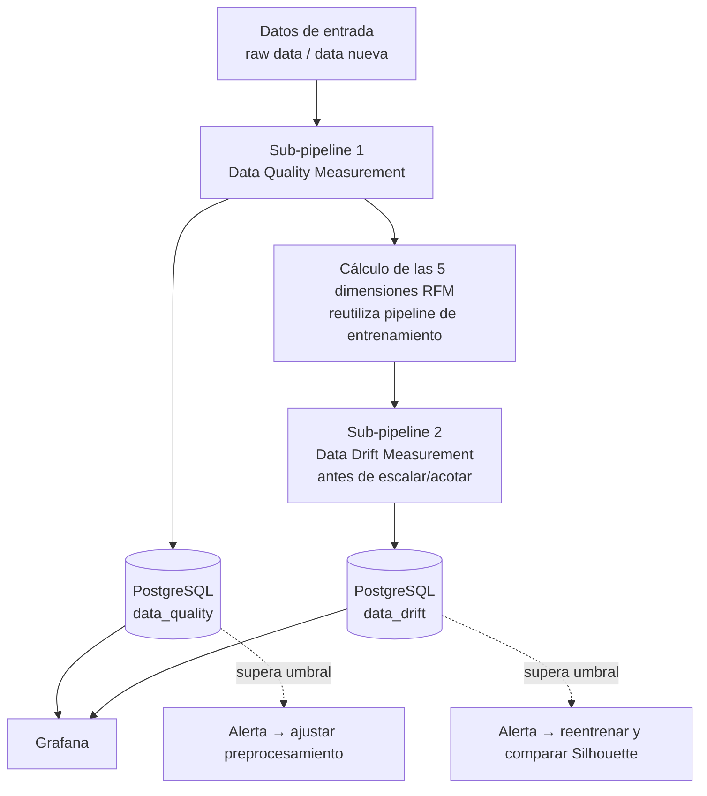

# Arquitectura del sistema de monitorización (draft)

> **Estado:** borrador. Las secciones marcadas como **Pendiente** aún no están definidas.

## 1. Componentes

| Componente | Tecnología | Notas |
|---|---|---|
| Backend | CloudWatch + scripts de Python | Muy probablemente |
| Database | PostgreSQL | Tablas `data_quality` y `data_drift` |
| Frontend | Grafana | |

## 2. Regla de decisión

Responde a: **¿qué pasa cuando un umbral es alcanzado?** Depende de dos escenarios:

### 2.1. Data Quality

- **Disparador:** alguna métrica de Data Quality supera su umbral.
- **Acción:** enviar una alerta (correo).
- **Respuesta esperada:** el ML engineer ajusta el pipeline de preprocesamiento, porque están cambiando las métricas de calidad de los datos.

### 2.2. Data Drift

- **Disparador:** alguna métrica de drift supera su umbral.
- **Acción:** enviar una alerta.
- **Respuesta esperada:** el ML engineer reentrena el modelo:
  1. Reentrenar un modelo.
  2. Comparar las performance metrics del nuevo modelo frente al antiguo. Al ser K-means, se comparan métricas como el **Silhouette Score**.

## 3. Pipeline de monitorización

### 3.0. Datos de entrada

Idealmente entra raw data.

> **Pendiente:** definir qué debe entrar: el raw data o la data nueva recabada que no ha sido usada para entrenamiento.

### 3.1. Sub-pipeline 1: Data Quality Measurement

Trabaja sobre los datos de entrada y calcula cinco métricas:

1. Cantidad de nulos.
2. Cantidad de valores duplicados.
3. Cantidad de valores inválidos.
4. Consistencia de las columnas.
5. Completitud de los datos de las columnas.

Los resultados se almacenan en la tabla **`data_quality`** (PostgreSQL).

### 3.2. Cálculo de las cinco dimensiones RFM

Se calculan las cinco dimensiones del modelo de clusterización (Recency, Frequency, Monetary, etc.). Ya existe un pipeline de entrenamiento que las calcula; posiblemente se reutilice.

### 3.3. Sub-pipeline 2: Data Drift Measurement

Se ejecuta sobre las cinco dimensiones RFM **antes del preprocesamiento** (escalado, acotado, etc.). Calcula dos indicadores:

1. **PSI (Population Stability Index):** cuantifica el cambio de una distribución.
2. **KS (Kolmogorov-Smirnov):** medida estadística que indica si la distribución cambió o no estadísticamente.

Los resultados se almacenan en la tabla **`data_drift`** (PostgreSQL).

## 4. Umbrales (thresholds)

### 4.1. KS

| Rango | Clasificación |
|---|---|
| 0 – 0.05 | Cambio pequeño |
| 0.05 – 0.1 | Cambio moderado |
| 0.1 – 0.2 | Cambio considerable |
| > 0.2 | Cambio importante |

### 4.2. PSI

| Rango | Clasificación |
|---|---|
| < 0.1 | Cambio pequeño |
| 0.1 – 0.25 | Cambio moderado |
| > 0.25 | Cambio significativo |

### 4.3. Data Quality

> **Pendiente:** definir los umbrales de las métricas de Data Quality.

## 5. Pendientes

- [ ] Definir los datos de entrada del pipeline (raw data vs. data nueva no usada en entrenamiento).
- [ ] Definir los umbrales de Data Quality.
- [ ] Definir qué nivel de KS/PSI dispara la alerta de drift.
